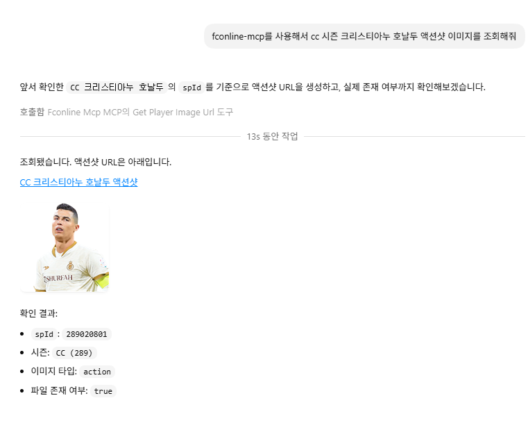

# fconline-mcp

`fconline-mcp`는 FC Online OpenAPI를 MCP(Model Context Protocol) 서버로 감싼 프로젝트입니다.
닉네임 조회, 최근 경기 요약, 매치 상세, 랭커 평균 스탯, 메타데이터 해석, 선수 이미지 URL 생성 같은 질의를 LLM 클라이언트가 안정적으로 처리할 수 있도록 설계했습니다.

## 프로젝트 소개

이 서버는 FC Online OpenAPI를 그대로 노출하는 수준에서 끝나지 않고, LLM이 바로 활용하기 좋은 형태로 응답을 정리해 주는 것을 목표로 합니다.

- Raw tools
  - 개별 OpenAPI endpoint를 가깝게 감싼 도구입니다.
  - 상위 애플리케이션이나 LLM이 세밀하게 조합하기 좋습니다.
- Composite tools
  - 여러 endpoint와 메타데이터를 묶어 사람이 읽기 쉬운 결과를 반환하는 도구입니다.
  - 최근 경기 요약, 프로필 요약, enriched match detail 같은 질의에 적합합니다.

## 주요 특징

- TypeScript + Node.js 20+
- 공식 MCP TypeScript SDK(`@modelcontextprotocol/sdk`) 기반 stdio 서버
- `zod` 기반 입력 검증
- 구조화된 JSON 응답
- raw 값과 해석된 label 동시 반환
- 메타데이터 TTL 캐시
- `matchType` 숫자 코드 / 한국어 라벨 동시 지원
- UTC / KST 시간 동시 제공
- GET 요청 대상 재시도 및 backoff 처리
- `shootDetail.goalTime` 디코드 지원
- `pid` 기반 이미지 조회 시 선행 0 제거
- 상대 participant가 누락된 match detail도 처리

## 지원 기능

이 프로젝트는 다음 기능을 모두 커버합니다.

1. `nickname -> ouid` 조회
2. 유저 기본 정보 조회
3. 유저 역대 최고 등급 조회
4. 유저 매치 ID 목록 조회
5. 본인 거래 기록 조회(`user/trade` 제약 반영)
6. 전체 매치 ID 목록 조회
7. 매치 상세 조회
8. 랭커 평균 스탯 조회
9. 메타데이터 조회
   - `matchtype`
   - `spid`
   - `seasonid`
   - `spposition`
   - `division`
   - `division-volta`
10. 선수 카드 / 액션 이미지 URL 생성 및 존재 확인
11. 메타데이터 기반 human-readable enrichment
12. 닉네임 기반 최근 경기 히스토리 및 요약

## 도구 목록

### Raw tools

- `resolve_user_by_nickname`
- `get_user_basic`
- `get_user_max_division`
- `get_user_matches`
- `get_user_trade`
- `get_matches`
- `get_match_detail`
- `get_ranker_stats`
- `get_metadata`
- `get_player_image_url`

### Composite tools

- `get_user_profile_summary_by_nickname`
- `get_user_match_history_by_nickname`
- `summarize_user_recent_matches_by_nickname`
- `get_match_detail_enriched`
- `get_ranker_stats_enriched`

## 예시 질의

- `닉네임 OOO의 최근 공식경기 5판 조회해줘`
- `OOO의 역대 최고 등급 보여줘`
- `이 matchId 상세 보여줘`
- `OOO의 최근 경기 요약해줘`
- `선수 이미지 URL 줘`
- `랭커 평균 스탯 조회해줘`

## 실제 동작 사진


## 빠른 시작

### 요구사항

- Node.js 20 이상
- FC Online OpenAPI Key

### 설치

```bash
npm install
```

### 환경변수 설정

```bash
NEXON_OPEN_API_KEY=your_api_key
```

예시 파일은 [`.env.example`](.env.example) 를 참고하면 됩니다.

### 빌드

```bash
npm run build
```

### 실행

```bash
npm start
```

## MCP 클라이언트 설정 예시

로컬 MCP 클라이언트에서는 보통 stdio 서버로 등록하면 됩니다.

```json
{
  "command": "node",
  "args": ["dist/server.js"],
  "env": {
    "NEXON_OPEN_API_KEY": "${NEXON_OPEN_API_KEY}"
  }
}
```

실제 등록 방식은 사용하는 MCP 클라이언트 환경에 맞게 조정하면 됩니다.

## 응답 설계 원칙

- 모든 tool은 JSON-serializable structured data를 반환합니다.
- 가능한 경우 raw ID와 resolved label을 함께 제공합니다.
- 시간 필드는 UTC와 KST를 함께 제공합니다.
- `matchType`, `division`, `season`, `position`, `player name` 등 해석 정보를 포함합니다.
- 에러는 구조화된 typed error 형태로 반환합니다.
- rate limit 상황에서는 `retryAfterSeconds` 힌트를 포함할 수 있습니다.

## FC Online API 반영 사항

구현 시 다음 문서 특성과 예외 상황을 반영했습니다.

- 데이터는 최신 시점 대비 약 2시간 지연될 수 있습니다.
- `/user/match` 와 `/match` 의 `matchtype` 설명이 서로 다릅니다.
- 메타데이터 숫자 필드는 문자열 / 숫자로 혼용될 수 있습니다.
- `user/trade` 는 본인 거래 기록만 조회할 수 있습니다.
- 이미지 API는 JSON API 서버가 아니라 CDN을 사용합니다.
- `pid` 기반 이미지 조회 시 선행 0 제거가 필요합니다.
- `match-detail` 은 상대 participant가 누락된 단일 participant 응답이 가능합니다.

## 개발 스크립트

```bash
npm run lint
npm test
npm run build
npm run dev
```

## 테스트

Vitest 기반 테스트를 포함합니다.

현재 주요 테스트 범위는 다음과 같습니다.

- 429 재시도 처리
- 메타데이터 혼합 타입 정규화
- `shootDetail.goalTime` 디코딩
- 단일 participant match 처리
- `pid` 선행 0 제거 이미지 URL 처리
- 랭커 스탯 응답 필드 alias 처리

## 프로젝트 구조

```text
src/
  config.ts
  server.ts
  service.ts
  nexon/
    client.ts
    errors.ts
    formatters.ts
    metadata.ts
    normalizers.ts
  tools/
    composite.ts
    helpers.ts
    raw.ts
  types/
    api.ts
    domain.ts
test/
README.md
.env.example
```

## 참고 문서

구현 시 기준 문서로 사용한 상세 정리본은 [`fconline-openapi-detailed-summary.md`](fconline-openapi-detailed-summary.md) 입니다.